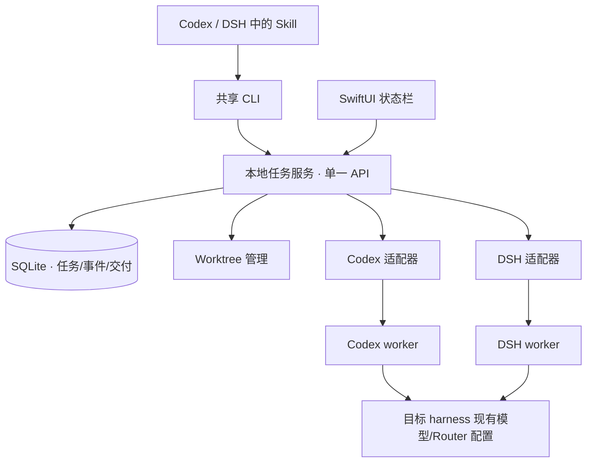
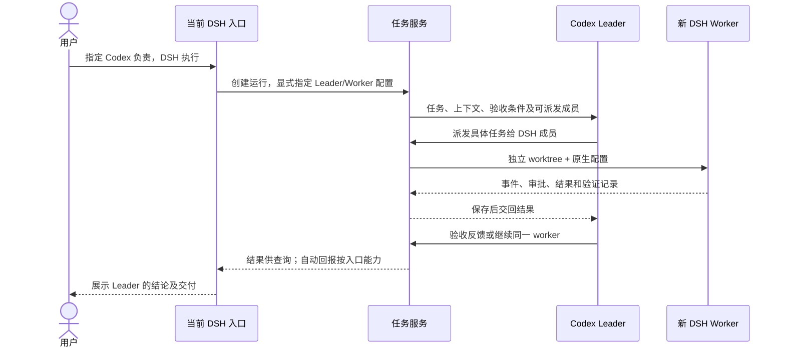

# 第一性原理与最小架构提案

状态：2026-10-21 架构推导与历史提案，随后根据 Q9/Q10 和 continue 指令形成实现。字段建议不是全部已交付能力；现行契约以 `specs/001-cross-harness-team/` 为准，验证状态见其 verification.md。一手源码证据见 `reference-architecture-review.md`。

## 必须成立的事实

1. 模型产生输出；harness 拥有上下文、工具循环、审批和会话。改 API 地址不等于执行另一个 harness。
2. Desktop 是入口和观察窗口，跨 harness 执行不必嵌入它的内部组件树。
3. 上下文不自动共享；交接必须明确目标、验收条件、目录/基线、约束和结果。
4. 异步意味着入口和 UI 可能退出，任务所有权不能只在视图、MCP 连接或内存中。
5. Worktree 隔离修改，不是安全沙箱。进程、网络和审批仍受目标 harness/操作系统约束。
6. 模型可用性取决于目标 harness 与已配置 provider；不能保证所有 harness × 所有模型都等价可用。
7. 可启动原生 worker，不代表能发现、挂接或自动唤醒已运行的 Desktop 会话。

项目因此只负责可靠交接、执行协调和交付。推理循环、provider 协议转换、账号管理由现有工具承担。

## 奥卡姆剃刀：每一层必须证明价值

| 机制 | 首版建议 | 理由与代价 |
| --- | --- | --- |
| 单一本地常驻服务 | 保留 | 异步生命周期独立于入口和 UI |
| 每家原生协议适配器 | 保留 | 审批、取消、会话、模型选项确有语义差异 |
| 单一任务 API 与持久状态 | 保留 | 避免 UI、CLI、通知各自维护任务真相 |
| Worktree 管理 | 保留 | 用户已选择隔离和审查交付 |
| SwiftUI 状态栏 | 保留 | 轻量呈现，不拥有执行循环 |
| 共享 CLI + 小型 Skill | 优先入口 | shell-capable harness 复用，避免逐家 Desktop 注入 |
| MCP 入口 | 按需延后 | MCP 不负责异步持久性；没有收益时不维护两套入口 |
| 模型网关与账号系统 | 不实现 | 复用 Magpie/harness，避免叠加协议翻译 |
| CDP/Inspector/私有请求重写 | 不作为核心依赖 | 版本与打包耦合；只考虑隔离的增强适配 |
| DAG/自治调度/角色市场 | 延后 | 先证明明确派发的一次交接闭环 |
| 通用插件总线 | 延后 | 两个适配器不足以证明动态插件框架必要 |
| 自动合并、默认全权限、递归派发 | 不作为默认 | 与已选审批和审查交付冲突，并放大失败范围 |

最少代码行数不等于最少复杂度。服务和适配器分别解决独立生命周期与协议差异，删去它们只会把复杂度藏入 UI 或脚本。

## 最小结构

原生 Desktop 自动唤醒是可选出口，不是执行链前提。任意已适配入口可调用同一服务，Leader 是任务角色。

## 入口、Leader 与 Worker 分开选择

用户补充的首要场景：在 DSH Desktop 或 CLI 中交流，指定 Codex 原生 harness 担任 Leader，再由其派发新的 DSH 原生 worker。Q9 已确认：允许新建 DSH worker，要求保留可用插件配置，不要求让当前正在交流的 DSH 会话承担 worker。

| 身份 | 本例 | 职责 |
| --- | --- | --- |
| 交流入口 | 当前 DSH 会话 | 收集用户要求、提交团队运行、查询/转交结果和追加要求 |
| Leader | 新建 Codex 原生会话 | 使用 Codex 的上下文与工具循环，规划、派发、检查结果和提出修改要求 |
| Worker | 新建 DSH 原生会话 | 在独立 worktree 中用 DSH 工具和已验证可用插件执行 |
| 本地任务服务 | 确定性基础设施 | 路由会话、保存状态、执行角色权限和处理审批，不自行代替模型做规划 |

从哪个应用进入，不决定哪个 harness 担任 Leader。新建任务时，Leader 默认可沿用入口，但用户显式指定必须优先。团队预设只需一个 Leader 和一份允许使用的 worker 配置清单，不需要通用 DAG 或自治角色市场。

拟议自然语言入口：“本任务由 Codex 担任 Leader，使用 Codex 默认模型；实现交给 DSH，使用已配置模型和可用插件；先给计划，再执行和回报。”实际由小型 Skill 将这些选择转换成同一服务契约；不会把 DSH 的原生模型循环替换为 Codex。

运行契约应分别保存 `entry_ref`、`leader_profile`、`allowed_worker_profiles`、每个角色的 native session，以及请求/实际解析的模型与插件配置。服务发给各角色的调用凭证按作用域限制：入口可提交/查询/追加用户要求，Leader 可在允许成员中派发，Worker 只能回报与处理自身任务；不能仅凭 prompt 声称角色就获得派发权。

这里需要修正早期“首版不递归派发”的表述：允许入口创建外部 Leader，Leader 再派发 Worker；仍禁止 Worker 继续创建下级团队。入口是通讯来源，不是多加一层自治 Leader。

桥不应在原始 DSH 会话等待工具结果时反向把它当执行 worker，以免互相等待或争用原生会话。追加要求路由给 Codex Leader；结果明确标注真实来源，不能由入口静默改写为自己的决策。

DSH worker 的插件须使用其原生加载机制，复用用户明确选择的已安装配置，不迁移到 Codex，也不复制凭据或改写全局配置。具体插件受后台 profile、工作目录和所需 UI/工具能力约束：无法复用或尚未验证时报告名称与原因，不能静默退化后声称已保留全部插件。Q10 已要求暂不逐项调查插件，具体插件兼容不作为 MVP 门槛，状态保留为未验证。

已核实官方源码：ACP 与 Desktop 为不同 profile，ACP 可以使用原生插件、磁盘 skills 与附加 MCP，但不会自动继承 Desktop 的全部配置。证据见 `docs/dsh-worker-plugins.md`；插件专项验证按 Q10 延后，工具不改写其全局配置。

这解释了与“Magpie 将 GPT 接入 DSH”的差别：后者仍是 DSH 的 agent 循环；本例的规划和调度确实运行于 Codex harness，DSH 的原生能力用于 Worker。结果可回到 DSH 入口，不代表 Codex 的完整原生 UI 能嵌入 DSH。

建议服务/CLI 使用 TypeScript，原生客户端使用 SwiftUI；收益是原生协议 JS 生态和 macOS 交互，代价是两个构建链及 IPC。若试验发现纯 Swift 同等可靠且明显减少打包成本，再收敛，不并行实现多个版本。

复用优先：先用短技术验证检查 acpx 0.20.0 的 in-process runtime 能否承载 DSH ACP 的逐次审批、取消和模型选择，通过就复用，不重写完整 ACP client。Codex 优先验证原生 app-server；若 acpx 的 Codex adapter 能保留相同必要语义，再比较复用收益。对每条会话只保留一个连接/进程所有者，避免 acpx queue owner 和自建 runner 同时管理。shared runtime 与 in-process runtime 的审批契约不同，不能互换后宣称行为等价。

共用仅绑定本机的 HTTP API；令牌仅当前用户可读，不放命令参数和日志；限制来源、请求体与路径。UI 不提供任意 shell 执行接口。采用一种适合 Node 和原生客户端的传输，首版不再增加第二套公共 RPC。具体后台启动和打包方式在计划中实测。

## 小而完整的契约

- 提交：request ID、入口会话引用、Leader 配置、允许的 Worker 配置、任务、验收条件、仓库与明确 base ref、请求模型及权限约束；派发任务另关联父运行和原生会话。
- 执行：任务 ID、worktree/分支、实际 harness 版本、native session ID、实际模型、事件序号、待处理审批和状态。
- 交付：摘要、差异引用、测试命令/实际退出码与输出、未完成项、原生结果引用。不能把模型总结当作执行证据。
- 操作：创建、查询、结果、继续、取消；审批绑定原生请求 ID，不变成通用提权入口。

未提交改动不静默复制给 worker：默认从明确 ref 建 worktree 并显示基线。需要复制时，使用独立可追踪的交接选项。

## 可靠性下限

1. 创建使用 request ID 去重，查询/重试不重复启动 worker。
2. SQLite 保存快照与必要事件，事务更新；不先建设通用 event-sourcing 框架。
3. 启动存在崩溃窗口；不能确认执行是否发生时标记中断/未知，先核查原生会话，不自动重跑。无原生幂等能力时不承诺外部操作恰好一次。
4. 重启先对账再恢复；适配器不能恢复时明确限制。落盘不等于无损恢复。
5. 执行结束、结果保存、通知送达、用户验收分别记录；通知失败不丢结果，也不将执行改为失败。
6. 取消请求与终止确认分离；断开不等于成功取消。杀进程兜底须管理子进程范围。
7. 审批默认不放行；过期/断开不能播放旧授权；信息不足明确显示。
8. 关闭 UI 只停止订阅；服务拥有 worker。事件按摘要节流，处理背压和输出大小。
9. 首版允许入口→Leader→Worker；不开放 Worker 再创建团队或任意递归派发。采用简单并发/超时上限；无可靠账单数据就不显示虚假成本保证。

## 能力不是宣传布尔值

每项能力记录 supported / unsupported / unverified、目标版本、验证方式和时间。至少分别记录：创建、续接、取消、审批、模型选择、后台存活、重启恢复、结果持久化、原生跳转、会话发现、授权挂接、自动唤醒。

优先验证 Codex app-server 和 DSH ACP。DSH 的模型选项是会话返回的 ID，应查询解析；不能假设任意模型字符串可用。依据前轮调查，仍须锁定版本做协议测试和真实运行，两者分别记录。

## 对正式规范的增补提案

- 核心不依赖修改厂商 Desktop、私有请求拦截或关闭审批。
- 双向入口共用任务契约，增强入口不改变任务真相。
- 模拟、持久化、执行成功、测试和代码验收分别留证。
- 新基础设施必须说明收益，以及更简单方案为何不足。
- UI 遵循 `design-system/harnmux/MASTER.md`，验证明暗、键盘及真实等待/错误状态。

以上为前五项产品决策增加架构和质量约束，不自动扩大到跨平台、所有 harness/模型、完整原生子 agent 树或桌面聊天客户端。
