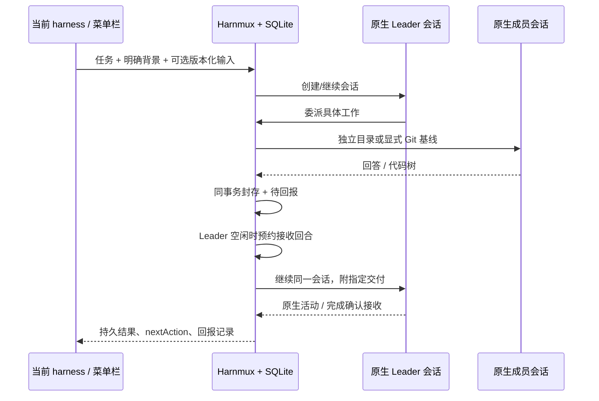

# Harnmux：通用协作与竞品经验的落地

2026-10-22。定位从跨 harness 编码委派扩展为：**保留熟悉的原生入口，让合适的
harness 协作处理聊天、研究、写作和代码，能看清交接内容、当前阻塞和交付版本。**
“最好用”是持续验证的目标，不是本轮可以证明的结论。

## 从用户需要推导架构

用户需要的是另一套 harness 的完整执行循环，而不只是换一个模型。因此成员仍运行
Codex app-server 或 DSH ACP；模型路由留给 Magpie/原生配置。只有需要协作时才委派，
简单聊天由一个负责人直接回答，不能强迫每个问题都经过规划、研究、审查流水线。

成员合作需要明确任务、必要背景和交付物，不需要复制所有聊天。共享背景显式提供；
其他回答使用 taskId/turn/digest 选择。代码额外需要可复现的文件树，因此使用 Git 快照。
聊天不需要这个约束，保留私有目录和回答即可。职责用 duty 描述，权限仍由 Leader/Worker
决定；没有新增 planner/reviewer 权限层级。

任务应该独立于窗口存活。状态与回报在同一个服务/SQLite 中，CLI、Skill 和原生菜单栏
调用同一套 API。不增加另一套聊天客户端、消息队列、模型平台、团队 DSL 或 Desktop 注入。

## 吸收了什么，付出什么代价

源码版本和行级证据沿用既有调研。本轮没有读取其他同名 Harness Bridge 仓库。

| 来源 | 值得吸收的经验 | 本轮原创实现 | 当前代价/边界 |
| --- | --- | --- | --- |
| CodexHost `a8adb78b519a81795fc05b787811f20a9738d7f0` | 原生会话引用、watch/read/send、不能把发送尝试等同于接收 | SQLite 回报状态；封存与入箱、接收回合与报告预约分别在事务中完成；原生活动确认 receipt | 不提供它的 Desktop 会话投影；只唤醒管理的 Leader |
| Harness Mix `b3e4b54d6a3a5043875b38cc39005bee7d2f1c85` | 私有 index 快照、持久 mailbox、忙闲调度、版本化审查 | 同一 commit 生成 diff 和下一成员的基线；忙时保存、闲时汇总；成员更新阻止旧汇总验收 | 不复制 DAG/脚本系统，尚无其丰富适配器和独立验证门禁 |
| [0xSero/harness-bridge](https://github.com/0xSero/harness-bridge) `d1cd1c77fe92367d4cd9e055fffaef8236a65930`，现名 Local AI | 一份核心驱动多个入口、原生薄 UI、清楚的连接/缓存状态 | 菜单栏的精简发起表单、待处理优先、nextAction、离线标识 | 不做它的模型发现/配置；本轮尚未完成原生交互实测 |

这些产品也有不少 Harnmux 尚不具备的能力。“我们解决了它们的问题”必须限定到具体
场景和配置，不能推导成整体更成熟或技术独有。产品实现未复制上述项目的代码；继续使用
已锁定、保留许可的 acpx 等依赖。`0xSero/harness-bridge` 的重点是模型与启动环境，
不能把它没有团队调度解读成其目标内的缺陷。

## 本轮用户体验

- 聊天、研究、写作：省略 repo 即可，回答可审阅、继续，不伪造代码 diff。
- 需要代码时：新建带 repo 的任务，用 input 引用讨论结论；从讨论到工程不必丢失决定。
- 选交付再交接：指定回答版本；代码任务可再选 codeFrom，不猜测工作区是否已经同步。
- 等待说明原因：自己的权限、成员权限、成员运行、待汇总、接收不确定分别显示。
- 成员晚完成：在管理的同一 Leader 会话继续汇总；忙时不插入第二个并发回合。
- 用户已取消：不因成员刚完成又自动开始；连同仍活动的成员一起请求停止。
- 接收不确定：保存事实，不自动重放。检查后可显式 continue --input，记录一次新的接收回合。
- 会话内容和交付保留：结果可确认、要求修改或继续。聊天的审阅动作是可选的，不阻止正常对话。

菜单栏采用现有系统语义色、SF 字体、原生控件、焦点和加载反馈。表单只保留一种主操作；
不确定提交保留同一个 requestId（落盘），刷新或重试查询同一任务，不开放盲目重复提交。
不把实现路径、事件 JSON 和摘要放进正常发起流程；它们只在详情中按需展开。

## 状态和交接的实际保证

回报的 delivered 表示原生有接收证据，不表示模型已正确理解或完成验证。
只在原生进程之外保存状态并不能防止所有重复副作用；unknown 必须停止自动重放。
历史包不改写；current 检查当前成员的集合、回合、状态、digest，阻止旧汇总冒充最新交付。

## 仍需真实使用验证

1. Codex/DSH 真模型双向协作：是否合理决定何时委派、正确读输入、避免重复工作。
2. DSH ACP 与用户 Desktop 配置的实际差异；没有更改插件、路由或账号配置。
3. 原生 UI 明暗、键盘/VoiceOver、放大字体、长审批、断线与不确定提交恢复。
4. Git 大仓库、LFS clean filters、子模块和磁盘保留策略。当前快照是 Git 树；忽略文件、
   外部目录和子模块工作内容没有复制，依赖安装也不随快照迁移。
5. 文件/图片附件和跨 harness 完整历史迁移不在这一文本版本。协议可用不代表原生全部功能可用。

这些项目按真实使用反馈排优先级，不在没有证据时加入更多基础设施。
